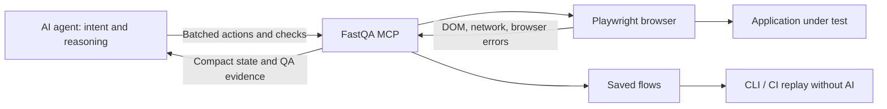
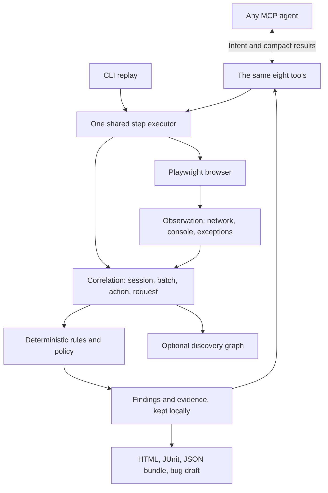
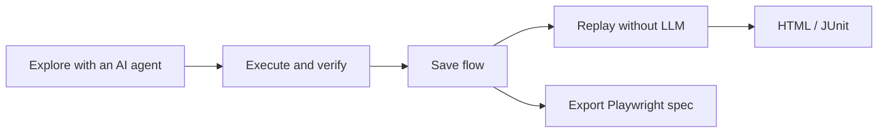

<div align="center">

# FastQA-MCP

### A QA-native browser interaction engine for AI agents

**Navigate faster. Observe deeper. Discover defects while interacting.**

[](https://www.npmjs.com/package/fastqa-mcp)
[](https://www.npmjs.com/package/fastqa-mcp)
[](#what-fastqa-can-test)
[](LICENSE)

[Quick start](#quick-start) · [How it works](#how-it-works) · [Continuous QA](#continuous-qa) · [Benchmarks](#speed-by-design) · [CI](#from-ai-exploration-to-deterministic-ci) · [Reference](docs/REFERENCE.md)

</div>

---

> **New in 1.0.** Continuous QA findings, evidence views, strict mode, session bundles, discovery and contract checks. The eight tools, saved flows and CLI exit codes work as they did in 0.3. Upgrading? Read the [changelog](CHANGELOG.md) for what changes in the output.

## Browser automation with a QA mindset

Most browser automation starts with a simple question: **Did the interaction work?**

FastQA adds another: **What happened behind the scenes?**

FastQA is an open-source MCP server built on Playwright. It gives an AI agent fast, compact browser control together with test assertions, network observations and error evidence. It can record a successful journey and replay it later without a model, including in CI.

- **Interact:** navigate, click, fill, select and verify in one batched call.
- **Observe:** collect HTTP activity, console errors and uncaught browser exceptions.
- **Verify:** assert UI state, network responses and accessibility.
- **Reproduce:** save flows, run them again without AI, and export Playwright tests.

FastQA does not need its own LLM, cloud service or database. Bring any compatible MCP client and model. The model decides what to test; FastQA handles browser execution and observations.

## The bugs your screen doesn't show

A test places an order. The page says "Thank you for your order". Behind it, a notification call fails and the UI never looks at the response.

A UI-only assertion passes. FastQA records the failed request and tells the agent without being asked. This is real output from the bundled demo shop:

```text
PASSED 2/2 steps in 343ms
✓ click "Place order" (34ms)
✓ expect_text "Thank you for your order" (1ms)
--- changes ---
url: http://127.0.0.1:4321/orders?notify=500
+ status "Thank you for your order"
⚠ 1 JS error(s), 1 failed request(s) so far — call evidence for details
QA: 1 new candidate finding (highest HIGH) · 2 requests observed
  F-001 HIGH NET-5XX POST /api/notifications returned 500 — A-2 click "Place order" (inferred) — E-10
  → leads, not confirmed defects: check them with evidence {view:"findings"} before reporting success
```

The steps still pass: the finding does not change them. It names the action that started the request and says how sure that link is (`inferred` means timing, not proof of cause). The failed request is evidence to investigate, not proof that the order failed.

To make such a failure fail the test, assert it: add an `expect_no_errors` or `expect_request` step, or run in strict mode.

> **Every interaction is a testing opportunity. Every observation is evidence. Every unexpected behaviour is a potential discovery.**

## Quick start

Setting up FastQA means telling your AI client which command starts it. You never run FastQA yourself. The client starts it in the background when it needs a browser and stops it when it is done.

### Step 1: check what you need

| You need | How to check | If it is missing |
|---|---|---|
| Node.js 20 or newer | Run `node --version` in a terminal. It should print `v20` or higher. | Install it from [nodejs.org](https://nodejs.org). |
| A browser FastQA can control | Google Chrome or Microsoft Edge on your computer is enough. | Run `npx playwright install chromium` once. It downloads a browser that only FastQA uses. |

There is nothing else to install. The first time the client starts FastQA, the package is downloaded automatically.

### Step 2: know the one command

Every setup below uses the same command:

```bash
npx -y fastqa-mcp
```

| Part | What it does |
|---|---|
| `npx` | A tool that comes with Node.js. It downloads a package if you do not have it yet, then runs it. |
| `-y` | Answers "yes" to the question npx asks before it installs something. Without it, the client would wait for an answer that nobody can type. |
| `fastqa-mcp` | The FastQA package. Written like this you get the newest version. Write `fastqa-mcp@1.0.1` to always get exactly that version, which is the safer choice for teams and for CI. |

To check that the command works on your computer, run `npx -y fastqa-mcp --version`. It prints a version number and exits.

### Claude Code

**The short way.** Run this once in a terminal, inside your project folder:

```bash
claude mcp add fastqa -- npx -y fastqa-mcp
```

| Part | What it does |
|---|---|
| `claude mcp add` | Tells Claude Code to remember a new MCP server. |
| `fastqa` | The name you give it. You will see this name in lists and in front of the tool names. |
| `--` | A separator. Everything after it is the command Claude Code runs to start the server. |
| `npx -y fastqa-mcp` | The command from step 2. |

**With options.** Options go between the name and the `--`:

```bash
claude mcp add fastqa --scope project --env FASTQA_HEADED=true --env FASTQA_TIMEOUT_MS=8000 -- npx -y fastqa-mcp@1.0.1
```

| Option | What it does |
|---|---|
| `--scope local` | The default when you leave `--scope` out. Only for you, only in this project folder. Saved in your personal `~/.claude.json`. |
| `--scope project` | Saved in a file called `.mcp.json` in the project folder. Commit that file and your teammates get the same setup. Claude Code asks each person to approve it the first time. |
| `--scope user` | Only for you, in every project on this computer. |
| `--env NAME=value` | Passes one FastQA setting. Repeat it for each setting. `-e` is the short form. The settings are listed under [All settings](#all-settings). |

In the example above, `FASTQA_HEADED=true` shows the browser window so you can watch, and `FASTQA_TIMEOUT_MS=8000` lets each step wait up to 8 seconds.

**As a file.** `--scope project` writes `.mcp.json` for you. You can also create or edit it by hand. This example sets every everyday option to its default value, plus one password placeholder, so you can see them all and change the ones you want:

```json
{
  "mcpServers": {
    "fastqa": {
      "type": "stdio",
      "command": "npx",
      "args": ["-y", "fastqa-mcp@1.0.1"],
      "env": {
        "FASTQA_HEADED": "false",
        "FASTQA_QUALITY": "observe",
        "FASTQA_TIMEOUT_MS": "5000",
        "FASTQA_VIEWPORT": "1280x800",
        "FASTQA_COOKIES": "keep",
        "FASTQA_MAX_LINES": "250",
        "FASTQA_DIR": ".fastqa",
        "FASTQA_VAR_password": "${FASTQA_VAR_password}"
      }
    }
  }
}
```

| Line | What it does |
|---|---|
| `"mcpServers"` | The list of MCP servers for this project. |
| `"fastqa"` | The name of this server. You choose it. |
| `"type": "stdio"` | The server is a program on your computer that Claude Code starts and talks to directly. Claude Code writes this line itself; it also works without it. |
| `"command"` and `"args"` | The command from step 2, split up: the program first, then each of its parts as a separate item. |
| `"env"` | The FastQA settings. You only need the lines you want to change; delete the rest. Every value is written in quotes, also numbers and `true` or `false`. |
| `"${FASTQA_VAR_password}"` | Means "take the value from the variable with this name in the terminal that started Claude Code". The real password is never written in the file. Set the variable before you start Claude Code (see [Credentials and safe execution](#credentials-and-safe-execution)), or delete this line if you do not use a password placeholder. |

**Check that it works.**

```bash
claude mcp list            # every server and whether it is connected
claude mcp get fastqa      # the details of this one
claude mcp remove fastqa   # undo the setup
```

Inside Claude Code, type `/mcp` to see the same list. A server that comes from `.mcp.json` shows "Pending approval" until you approve it in a Claude Code session.

The first start downloads the package, which can take a moment. If Claude Code reports that the server did not start in time, start Claude Code once with a longer limit: `MCP_TIMEOUT=60000 claude` gives it 60 seconds (in PowerShell: `$env:MCP_TIMEOUT=60000; claude`).

### OpenCode

OpenCode reads its setup from a file named `opencode.json`. Put it in your project folder to use FastQA in that project, or in `~/.config/opencode/opencode.json` to use it everywhere. If the file already exists, add the `mcp` part to it; do not replace the whole file.

This example sets every everyday option to its default value, plus one password placeholder:

```json
{
  "$schema": "https://opencode.ai/config.json",
  "mcp": {
    "servers": {
      "fastqa": {
        "type": "local",
        "command": ["npx", "-y", "fastqa-mcp@1.0.1"],
        "environment": {
          "FASTQA_HEADED": "false",
          "FASTQA_QUALITY": "observe",
          "FASTQA_TIMEOUT_MS": "5000",
          "FASTQA_VIEWPORT": "1280x800",
          "FASTQA_COOKIES": "keep",
        "FASTQA_COOKIES": "keep",
          "FASTQA_MAX_LINES": "250",
          "FASTQA_DIR": ".fastqa",
          "FASTQA_VAR_password": "{env:FASTQA_VAR_password}"
        },
        "disabled": false,
        "timeout": { "startup": 60000 }
      }
    }
  }
}
```

| Line | What it does |
|---|---|
| `"$schema"` | Lets your editor check the file and suggest keys as you type. Optional. |
| `"mcp"` → `"servers"` | The list of MCP servers. |
| `"fastqa"` | The name of this server. You choose it. OpenCode puts it in front of every tool name: `fastqa_open`, `fastqa_act` and so on. |
| `"type": "local"` | The server is a program on your computer, not an address on the internet. |
| `"command"` | The command from step 2: the program first, then each of its parts as a separate item. |
| `"environment"` | The FastQA settings. You only need the lines you want to change; delete the rest. Every value is written in quotes. |
| `"{env:FASTQA_VAR_password}"` | Means "take the value from the variable with this name in the terminal that started OpenCode". The real password is never written in the file. Delete this line if you do not use a password placeholder. |
| `"disabled"` | `true` keeps the entry but does not start the server. Handy for switching FastQA off for a while. |
| `"timeout"` → `"startup"` | How long OpenCode waits for the server to start, in milliseconds. 60000 is one minute, which leaves room for the first download. |

The smallest version that works is just `type` and `command`:

```json
{
  "$schema": "https://opencode.ai/config.json",
  "mcp": { "servers": { "fastqa": { "type": "local", "command": ["npx", "-y", "fastqa-mcp"] } } }
}
```

**Older OpenCode versions** put the server directly under `"mcp"`, without `"servers"`, and switch it on and off with `"enabled"`. If your version reports a configuration error with the example above, use this layout:

```json
{
  "$schema": "https://opencode.ai/config.json",
  "mcp": {
    "fastqa": {
      "type": "local",
      "command": ["npx", "-y", "fastqa-mcp"],
      "enabled": true,
      "environment": { "FASTQA_HEADED": "false" }
    }
  }
}
```

Both layouts were tested with OpenCode 1.19.

**Check that it works.** Restart OpenCode after changing the file, then run:

```bash
opencode mcp list   # shows "fastqa connected" when everything is fine
```

OpenCode can also write the entry for you: `opencode mcp add fastqa --env FASTQA_HEADED=false -- npx -y fastqa-mcp`. It prints which file it changed. Check that it is the one you meant: depending on the version and the folder you run it in, that is the project file or your global one.

### Other MCP clients

Any client that can start a local MCP server works. Most of them use the same `mcpServers` block as Claude Code:

```json
{
  "mcpServers": {
    "fastqa": {
      "command": "npx",
      "args": ["-y", "fastqa-mcp"],
      "env": { "FASTQA_HEADED": "false" }
    }
  }
}
```

| Client | Where the block goes | What is different |
|---|---|---|
| Claude Desktop | `claude_desktop_config.json`. Open it from Settings → Developer → Edit Config. | Nothing. Quit Claude Desktop completely and open it again afterwards. |
| Cursor | `.cursor/mcp.json` in the project, or `~/.cursor/mcp.json` for all projects. | Nothing. |
| VS Code (Copilot) | `.vscode/mcp.json` in the project. | The top-level key is `"servers"` instead of `"mcpServers"`, and the entry needs the extra line `"type": "stdio"`. |

These files belong to the clients and their format changes from time to time. If something here does not match what you see, the client's own documentation is right.

### All settings

Settings are passed as environment variables: the `--env` option or the `env` block in Claude Code, the `environment` block in OpenCode. All of them are optional.

| Setting | Default | What it does |
|---|---|---|
| `FASTQA_HEADED` | `false` | `true` opens a real browser window so you can watch what happens. `false` runs the browser invisibly, which is faster and what CI needs. |
| `FASTQA_QUALITY` | `observe` | What FastQA does with problems it notices by itself, such as failed requests and script errors. `observe` reports them and never fails a step because of them. `strict` also fails a run when a problem is serious (`high` by default). `discovery` works like observe and also keeps a map of the pages and API calls it saw. `debug` works like observe and may store response bodies if the config file allows it. `off` hides the `QA:` line completely. |
| `FASTQA_TIMEOUT_MS` | `5000` | How long a step waits for its button, field or text before it fails, in milliseconds. 5000 is 5 seconds. Raise it for slow sites. |
| `FASTQA_VIEWPORT` | `1280x800` | The size of the browser window, as width x height in pixels. |
| `FASTQA_COOKIES` | `keep` | What FastQA does with a cookie banner each time it opens a page. `accept` clicks the button that accepts, `reject` clicks the button that refuses, `keep` leaves the banner alone. The agent can still choose differently for a single page. See [Cookie banners](#cookie-banners). |
| `FASTQA_MAX_LINES` | `250` | The most lines of page description FastQA sends back at once. A lower number saves tokens on very large pages; a higher one shows more of the page. |
| `FASTQA_DIR` | `.fastqa` | The folder where FastQA keeps saved flows, reports, screenshots and its config file. A relative path starts at the folder the client starts FastQA in, which is usually your project folder. |
| `FASTQA_VAR_<name>` | not set | The value for a `{{name}}` placeholder. With `FASTQA_VAR_password` set, the agent types `{{password}}` and FastQA fills in the real value, so the password never appears in the conversation. You can define as many as you need, for example `FASTQA_VAR_email`. Names that look secret (such as `password`, `token`, `secret`, `pin`, `api_key`) are also hidden in everything FastQA returns, as long as the value has at least 6 characters. |
| `FASTQA_IGNORE_HTTPS_ERRORS` | see the right column | `true` opens sites whose HTTPS certificate is invalid or self-signed, which is common on test servers. `false` refuses them. If you set nothing, they are opened while there is no `.fastqa/config.json` and refused once that file exists. |
| `FASTQA_CAPTURE` | not set | Set it to `off` to make sure FastQA never stores response bodies, whatever the config file says. |
| `FASTQA_STRUCTURED` | `false` | `true` also returns each result as machine-readable data. Leave it off unless you know your client needs it: some clients then pass only that data to the model and drop the readable text. |
| `FASTQA_CHROME` | not set | The full path of the browser program to use, when you want one specific Chrome or Chromium. On Windows, write every `\` twice inside a JSON file. |
| `FASTQA_CDP_URL` | not set | Connects to a Chrome you started yourself instead of opening a new one, for example to test in a window where you are already logged in. Start Chrome with `--remote-debugging-port=9222` and set this to `http://127.0.0.1:9222`. FastQA does not close that browser when it is done. |

For `FASTQA_HEADED`, the values `1` and `yes` also count as `true`. Rules for what counts as a problem, expected errors and limits live in `.fastqa/config.json`; see the [reference](docs/REFERENCE.md#configuration-file).

### If it does not start

- **The client does not list FastQA, or says it failed.** Run `npx -y fastqa-mcp --version` in a terminal. If that prints a version, the package is fine and the problem is in the client's file: check the file name, the folder and the commas and brackets.
- **"Could not launch a browser".** Run `npx playwright install chromium`, or set `FASTQA_CHROME` to the path of a browser you have.
- **Windows.** Some clients cannot start `npx` directly on Windows. If the server does not start, use `cmd` as the command and put `/c`, `npx`, `-y`, `fastqa-mcp` in the arguments, for example `claude mcp add fastqa -- cmd /c npx -y fastqa-mcp`.
- **You changed a setting and nothing happened.** Restart the client. It reads the settings only when it starts the server.

### Your first test

Ask your agent, in normal words:

> Use FastQA to open https://staging.example.com/login. Log in as qa.user@example.com using the password placeholder `{{password}}`. Add the Blue T-shirt to the cart, place a test order, check the success message and that POST /api/orders returned 201. Check for unexpected browser or server errors. If it passes, save the flow as checkout.

Replace the URL, data and expected results with those of a test environment you are allowed to test. Avoid real purchases and shared production data.

The agent turns this into tool calls. One `act` call can carry the whole sequence:

```json
{
  "steps": [
    { "do": "fill", "target": "Email", "value": "qa.user@example.com" },
    { "do": "fill", "target": "Password", "value": "{{password}}" },
    { "do": "click", "target": "Log in" },
    { "do": "expect_url", "value": "/dashboard" },
    { "do": "expect_text", "value": "Welcome back" },
    { "do": "expect_no_errors" }
  ]
}
```

This is tool input, not a shell command. The agent writes it for you.

## How it works



The agent owns the reasoning. FastQA owns the execution. Keeping those apart lets the same engine serve different models and clients.

### Eight tools, not dozens

| Tool | Responsibility |
|---|---|
| `open` | Open a page, begin recording, optionally emulate a device or answer the cookie banner |
| `act` | Run up to 50 steps with built-in checks and compact results |
| `snapshot` | Inspect interactive elements or the fuller visible page state |
| `screenshot` | Capture visual evidence when it is useful |
| `audit` | Run an axe-core accessibility scan |
| `evidence` | Retrieve recorded browser errors and failed requests; drill into findings, network and timeline |
| `flow` | Start, save, list, inspect, run or export recorded journeys |
| `close` | Close the browser |

See the [reference](docs/REFERENCE.md) for parameters, assertions and limits.

## Speed by design

Instead of asking a model to decide every obvious click, FastQA runs a sequence of steps locally. Semantic targets avoid extra snapshots, incremental snapshots avoid repeated context, and checks run inside the same batch.

The repository's benchmark runs the same login, cart and currency journey on the bundled demo shop:

| Metric | @playwright/mcp 0.0.86 | FastQA 1.0 |
|---|---:|---:|
| Tool calls / model turns | 10 | **2** |
| Returned tokens (approx.) | 1,270 | **330** |
| Tool schema tokens (approx.) | 5,300 | **1,920** |
| Browser-side time, one run | 3.1 s | **2.5 s** |
| Estimated end-to-end at 3 s per model turn | ~33 s | **~8.5 s** |
| Replay of the saved flow | needs the model again | **1.4 s, no model** |

These are results for one small fixture on one machine, not universal guarantees. The end-to-end row is an estimate that assumes 3 seconds per model turn; no live model was timed. Reproduce with `npm run bench`. Real results depend on the site, client, model, hardware and network.

The observation layer added in 1.0 was measured against 0.3.2 on the same fixture with 30 warm runs (`npm run perf`): the same 2 tool calls, median and p95 browser-side time within 1%, clean responses 3% to 11% larger (one extra line), and tool schemas of about 1,840 tokens instead of 1,420. Method and numbers are in the [reference](docs/REFERENCE.md#measured-performance).

## What FastQA can test

| Capability | Example |
|---|---|
| UI state | Visible text, page URL and title, field values, control state, element count |
| Network checks | A matching HTTP request returned the expected status |
| Hidden errors | No unexpected page exceptions, console errors or failed network calls |
| Accessibility | Automated WCAG-oriented axe checks (not a complete accessibility audit) |
| Mobile view | A supported emulated device |
| Cookie banners | Accept or reject the banner while the page opens, so the test starts on the real page |
| File uploads | Upload made test files of any type and exact size, or your own files from `.fastqa/files` |
| Complex UI | Frames, nested frames and open shadow roots |
| Data-driven runs | Replay a flow with CSV input |
| Reporting | Failure screenshots, HTML and JUnit XML |

### Cookie banners

Most sites open with a cookie banner that covers the page. FastQA can answer it, so the test starts on the page itself.

- **For one page.** The agent adds `cookies` when it opens the page: `open { "url": "https://example.com", "cookies": "reject" }`. The value is `"accept"`, `"reject"` or `"keep"` (leave the banner alone). You can ask for it in normal words: "open example.com and reject the cookies".
- **For every page.** Set `FASTQA_COOKIES` to `accept` or `reject` in the client settings (see [All settings](#all-settings)). The agent can still pass `cookies` for a single page.
- **In the middle of a test.** `{ "do": "cookies", "value": "accept" }` is a step in `act`, like `click` or `fill`.

What you get:

- FastQA waits for the banner while the page is still loading things, at most 2.5 seconds. A page that has gone quiet is not waited on, so a page without a banner costs about 0.8 seconds extra. Then it clicks the button, waits for the banner to go away and returns the page without it. The result has a line such as `✓ cookies "reject" — clicked "Reject all"`.
- A page without a banner is not an error. The line says `no cookie banner found` and the test goes on.
- `reject` only clicks a button that really refuses. If the banner offers nothing but "Accept" and "Settings", or "Reject and subscribe", FastQA leaves it alone and lists the buttons it saw, so the agent can decide what to do next.
- The answer is recorded. A saved flow answers the banner again when it is replayed, and an exported Playwright spec contains the same step.

FastQA finds the button by the ids of common consent tools (OneTrust, Cookiebot, Didomi, Usercentrics, Google's consent message and others). For any other banner it reads the words on the buttons, in English, Bulgarian, German, French, Spanish, Italian, Dutch, Portuguese and Polish. Words only count inside a block that looks like a cookie banner, so an ordinary "Accept" button elsewhere on the page is not touched. Banners inside iframes and open shadow DOM are covered.

No detection covers every site. If a banner is missed, click its button with a normal `click` step. Without `cookies` and without `FASTQA_COOKIES`, FastQA does not touch banners at all.

### File uploads

Many forms ask for a file: a profile picture, an ID scan, a CSV to import. The `upload` step chooses files for a file input, as a person does in the file picker. You can ask for it in normal words: "upload a 6 MB photo and check that the form refuses it".

```json
{ "do": "upload", "target": "Select picture", "value": "photo.png" }
```

- **Test files without preparing any.** A name is enough: `"photo.png"` gives a small valid PNG. Add a size to test limits: `"big.jpg:6MB"`, or `"edge.png:5242881"` for one byte over 5 MB. `"empty.pdf:0B"` is an empty file. Made files stay valid files of their type at any size (PNG, JPEG, GIF, WebP, PDF, TXT, CSV, JSON, SVG, XML, HTML), so a size test fails on the size and not on a broken file. Other extensions, such as `"virus.exe"`, get filler bytes, for checking that the site refuses them.
- **Your own files.** Put them in `.fastqa/files/` and write `"files/contract.pdf"`. Nothing else on your disk can be uploaded: other paths are refused, so a page under test cannot talk the agent into uploading your keys or your `.env`.
- **Several files, or none.** `"a.png|b.pdf"` chooses two files. `""` clears the selection.
- **Any upload widget.** The target can be the input's label, a styled "Upload" button or a drop zone that opens the file picker. When the page has a single file input, the target can be left out. Hidden inputs work too; the snapshot lists them as `file … [hidden]`.

The result names each file with its exact size, such as `✓ upload "Select picture" "big.jpg:6MB" — big.jpg (6291456 bytes = 6 MB, made)`. When a file is not in the input's `accept` list, the line says so: the site's own check is then what is being tested. The upload is recorded, so a saved flow makes the same files again on replay and an exported Playwright spec has the same step. File contents never appear in results, evidence or saved flows. See the [reference](docs/REFERENCE.md#file-uploads) for every option.

## Continuous QA

While steps run, FastQA watches the browser and applies deterministic rules. Results end with a `QA:` line. On a clean batch that is one short line. When something was noticed, it lists candidate findings with the action they belong to and the ids of the evidence.



What it does:

- **Finds without being asked.** Failed first-party calls, transport failures, uncaught exceptions and console errors become candidate findings. Third-party traffic is not flagged.
- **Ties findings to actions, honestly.** A request belongs to the action that started it, even if the response arrives during a later step or after the batch returned. The link is labelled `direct`, `inferred`, `ambiguous` or `unattributed`.
- **Respects negative tests.** Assert the expected error (`expect_request "POST /api/orders" "422"`) or declare it in a scoped policy, and it is not reported as a finding.
- **Keeps clean runs cheap.** Details stay local. The agent drills in with `evidence {finding:"F-001", details:true}`, `{view:"network"}` or `{view:"timeline"}` only when it needs to.
- **Four modes over one pipeline.** `observe` (default) never changes a result. `strict` fails a run on findings at a configured severity. `discovery` maps the routes and endpoints it saw. `debug` allows scoped payload capture.
- **Optional deeper checks,** all off until configured: HTTP 200 responses that say `success: false`, OpenAPI contract mismatches, response-time limits and baselines, and UI state expectations after a response.
- **Evidence you can hand over.** A sanitized session bundle and a candidate bug draft in Markdown, with reproduction steps as executed and the limits stated.
- **Privacy first.** Metadata only by default. Query values, credentials and recognised secrets are removed from every output. Payload capture is opt-in, allowlisted and bounded.

What it does not do: it does not prove correctness, it does not test what the agent did not exercise, and a finding is a lead to verify, not a confirmed defect. Backend-only traffic and business intent that never reach the browser are not visible to it. See the [reference](docs/REFERENCE.md#continuous-qa) for rules, modes, configuration and limits.

## From AI exploration to deterministic CI



After your agent saves a flow, run it without a model:

```bash
npx fastqa-mcp run checkout
npx fastqa-mcp run '*'
npx fastqa-mcp run login --data=users
```

The wildcard example uses POSIX quoting; on Windows use the quoting of your shell. The exit code is 0 when every flow passed and 1 when one failed, so it works as a pipeline stage. Use the JUnit XML in Jenkins or any other CI system.

`--mode=strict` also fails the run on QA findings at or above the configured severity, and `--bundle` leaves a sanitized session bundle for investigation. Exported Playwright specs contain executable network, error and accessibility assertions.

### Where your files go

```text
.fastqa/
  flows/      Saved JSON flows
  data/       Local CSV datasets
  reports/    HTML and JUnit results
  artifacts/  Failure screenshots
  tests/      Exported Playwright specs
  sessions/   Session bundles (opt-in)
```

Open `reports/latest.html` for the latest replay report. Protect this directory and do not commit sensitive test data.

## Credentials and safe execution

Do not put real passwords in prompts or committed MCP configurations. Use `{{password}}` placeholders and provide `FASTQA_VAR_password` from a local or CI secret store before starting the client:

```bash
export FASTQA_VAR_password='the-real-password'     # Mac / Linux
setx FASTQA_VAR_password "the-real-password"       # Windows (then open a new terminal)
```

FastQA fills the value in at the last moment and masks password fields in its snapshots. This is not a guarantee that arbitrary page content, screenshots or artifacts contain nothing sensitive.

Run only against applications you are allowed to test. Use isolated test accounts, review generated flows and protect artifacts. Do not let an agent repeat purchases or other irreversible operations unattended.

## Current limitations

FastQA targets Chromium-based browsers. Closed shadow roots are not reachable, CSS `expect_count` covers the main frame only, and one page is active at a time. Semantic targets pick the first visible match, so use a ref or a scoped selector for ambiguous controls, or strict locators, which refuse to guess. The accessibility checks do not replace a manual assessment. Prefer explicit state assertions over sleeps. Details are in the [reference](docs/REFERENCE.md#limitations).

## Develop and contribute

```bash
git clone https://github.com/VnKk8/FastQA-MCP.git
cd FastQA-MCP
npm ci
npx playwright install chromium
npm test
npm run bench
```

To use the source build as your MCP server, point your client at `node /absolute/path/to/FastQA-MCP/dist/index.js` after `npm run build`. For example:

```bash
claude mcp add fastqa -- node /absolute/path/to/FastQA-MCP/dist/index.js
```

CI runs the tests on Node 20, 22 and 24 and checks that the committed `dist/` matches the source. Releases go through the repository's release workflow; do not publish by hand.

Useful links: [technical reference](docs/REFERENCE.md) · [changelog](CHANGELOG.md) · [npm](https://www.npmjs.com/package/fastqa-mcp) · [issues](https://github.com/VnKk8/FastQA-MCP/issues).

Contributions are welcome, especially reproducible bug reports, small fixture-based tests, browser edge cases, privacy improvements and performance measurements. Keep FastQA fast, portable, evidence-driven and independent of any specific model.

MIT. See [LICENSE](LICENSE).
