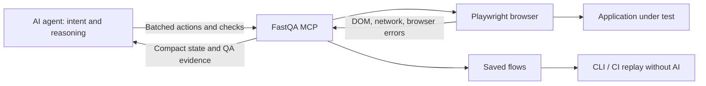
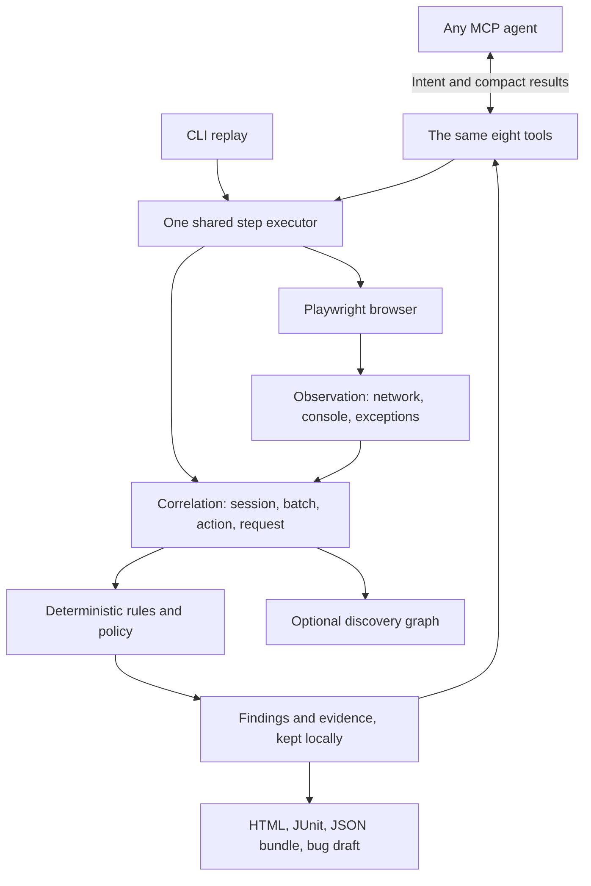
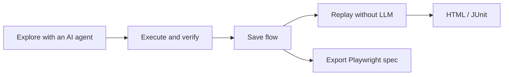

<div align="center">

# FastQA-MCP

### A QA-native browser interaction engine for AI agents

**Navigate faster. Observe deeper. Discover defects while interacting.**

[](https://www.npmjs.com/package/fastqa-mcp)
[](https://www.npmjs.com/package/fastqa-mcp)
[](#what-fastqa-can-test)
[](LICENSE)

[Quick start](#quick-start) · [How it works](#how-it-works) · [Continuous QA](#continuous-qa) · [Benchmarks](#speed-by-design) · [CI](#from-ai-exploration-to-deterministic-ci) · [Reference](docs/REFERENCE.md)

</div>

---

> **New in 1.0.** Continuous QA findings, evidence views, strict mode, session bundles, discovery and contract checks. The eight tools, saved flows and CLI exit codes work as they did in 0.3. Upgrading? Read the [changelog](CHANGELOG.md) for what changes in the output.

## Browser automation with a QA mindset

Most browser automation starts with a simple question: **Did the interaction work?**

FastQA adds another: **What happened behind the scenes?**

FastQA is an open-source MCP server built on Playwright. It gives an AI agent fast, compact browser control together with test assertions, network observations and error evidence. It can record a successful journey and replay it later without a model, including in CI.

- **Interact:** navigate, click, fill, select and verify in one batched call.
- **Observe:** collect HTTP activity, console errors and uncaught browser exceptions.
- **Verify:** assert UI state, network responses and accessibility.
- **Reproduce:** save flows, run them again without AI, and export Playwright tests.

FastQA does not need its own LLM, cloud service or database. Bring any compatible MCP client and model. The model decides what to test; FastQA handles browser execution and observations.

## The bugs your screen doesn't show

A test places an order. The page says "Thank you for your order". Behind it, a notification call fails and the UI never looks at the response.

A UI-only assertion passes. FastQA records the failed request and tells the agent without being asked. This is real output from the bundled demo shop:

```text
PASSED 2/2 steps in 343ms
✓ click "Place order" (34ms)
✓ expect_text "Thank you for your order" (1ms)
--- changes ---
url: http://127.0.0.1:4321/orders?notify=500
+ status "Thank you for your order"
⚠ 1 JS error(s), 1 failed request(s) so far — call evidence for details
QA: 1 new candidate finding (highest HIGH) · 2 requests observed
  F-001 HIGH NET-5XX POST /api/notifications returned 500 — A-2 click "Place order" (inferred) — E-10
  → leads, not confirmed defects: check them with evidence {view:"findings"} before reporting success
```

The steps still pass: the finding does not change them. It names the action that started the request and says how sure that link is (`inferred` means timing, not proof of cause). The failed request is evidence to investigate, not proof that the order failed.

To make such a failure fail the test, assert it: add an `expect_no_errors` or `expect_request` step, or run in strict mode.

> **Every interaction is a testing opportunity. Every observation is evidence. Every unexpected behaviour is a potential discovery.**

## Quick start

Requires Node.js 20+ and a supported browser (installed Chrome or Edge, or Playwright Chromium):

```bash
npx playwright install chromium
```

### Claude Code

```bash
claude mcp add fastqa -- npx -y fastqa-mcp
```

### OpenCode

Add the server to `opencode.json` (merge it into your existing configuration):

```json
{
  "$schema": "https://opencode.ai/config.json",
  "mcp": {
    "fastqa": {
      "type": "local",
      "command": ["npx", "-y", "fastqa-mcp"],
      "enabled": true,
      "environment": { "FASTQA_HEADED": "false" }
    }
  }
}
```

Restart the client. For a visible browser set `FASTQA_HEADED=true`. For reproducible CI, pin the version you validated, such as `fastqa-mcp@1.0.0`.

### Other MCP clients

Use stdio with the command `npx -y fastqa-mcp`. For clients that use the common `mcpServers` format:

```json
{
  "mcpServers": {
    "fastqa": { "command": "npx", "args": ["-y", "fastqa-mcp"] }
  }
}
```

### Your first test

Ask your agent, in normal words:

> Use FastQA to open https://staging.example.com/login. Log in as qa.user@example.com using the password placeholder `{{password}}`. Add the Blue T-shirt to the cart, place a test order, check the success message and that POST /api/orders returned 201. Check for unexpected browser or server errors. If it passes, save the flow as checkout.

Replace the URL, data and expected results with those of a test environment you are allowed to test. Avoid real purchases and shared production data.

The agent turns this into tool calls. One `act` call can carry the whole sequence:

```json
{
  "steps": [
    { "do": "fill", "target": "Email", "value": "qa.user@example.com" },
    { "do": "fill", "target": "Password", "value": "{{password}}" },
    { "do": "click", "target": "Log in" },
    { "do": "expect_url", "value": "/dashboard" },
    { "do": "expect_text", "value": "Welcome back" },
    { "do": "expect_no_errors" }
  ]
}
```

This is tool input, not a shell command. The agent writes it for you.

## How it works



The agent owns the reasoning. FastQA owns the execution. Keeping those apart lets the same engine serve different models and clients.

### Eight tools, not dozens

| Tool | Responsibility |
|---|---|
| `open` | Open a page, begin recording, optionally emulate a device |
| `act` | Run up to 50 steps with built-in checks and compact results |
| `snapshot` | Inspect interactive elements or the fuller visible page state |
| `screenshot` | Capture visual evidence when it is useful |
| `audit` | Run an axe-core accessibility scan |
| `evidence` | Retrieve recorded browser errors and failed requests; drill into findings, network and timeline |
| `flow` | Start, save, list, inspect, run or export recorded journeys |
| `close` | Close the browser |

See the [reference](docs/REFERENCE.md) for parameters, assertions and limits.

## Speed by design

Instead of asking a model to decide every obvious click, FastQA runs a sequence of steps locally. Semantic targets avoid extra snapshots, incremental snapshots avoid repeated context, and checks run inside the same batch.

The repository's benchmark runs the same login, cart and currency journey on the bundled demo shop:

| Metric | @playwright/mcp 0.0.86 | FastQA 1.0 |
|---|---:|---:|
| Tool calls / model turns | 10 | **2** |
| Returned tokens (approx.) | 1,270 | **330** |
| Tool schema tokens (approx.) | 5,300 | **1,840** |
| Browser-side time, one run | 3.1 s | **2.5 s** |
| Estimated end-to-end at 3 s per model turn | ~33 s | **~8.5 s** |
| Replay of the saved flow | needs the model again | **1.4 s, no model** |

These are results for one small fixture on one machine, not universal guarantees. The end-to-end row is an estimate that assumes 3 seconds per model turn; no live model was timed. Reproduce with `npm run bench`. Real results depend on the site, client, model, hardware and network.

The observation layer added in 1.0 was measured against 0.3.2 on the same fixture with 30 warm runs (`npm run perf`): the same 2 tool calls, median and p95 browser-side time within 1%, clean responses 3% to 11% larger (one extra line), and tool schemas of about 1,840 tokens instead of 1,420. Method and numbers are in the [reference](docs/REFERENCE.md#measured-performance).

## What FastQA can test

| Capability | Example |
|---|---|
| UI state | Visible text, page URL and title, field values, control state, element count |
| Network checks | A matching HTTP request returned the expected status |
| Hidden errors | No unexpected page exceptions, console errors or failed network calls |
| Accessibility | Automated WCAG-oriented axe checks (not a complete accessibility audit) |
| Mobile view | A supported emulated device |
| Complex UI | Frames, nested frames and open shadow roots |
| Data-driven runs | Replay a flow with CSV input |
| Reporting | Failure screenshots, HTML and JUnit XML |

## Continuous QA

While steps run, FastQA watches the browser and applies deterministic rules. Results end with a `QA:` line. On a clean batch that is one short line. When something was noticed, it lists candidate findings with the action they belong to and the ids of the evidence.



What it does:

- **Finds without being asked.** Failed first-party calls, transport failures, uncaught exceptions and console errors become candidate findings. Third-party traffic is not flagged.
- **Ties findings to actions, honestly.** A request belongs to the action that started it, even if the response arrives during a later step or after the batch returned. The link is labelled `direct`, `inferred`, `ambiguous` or `unattributed`.
- **Respects negative tests.** Assert the expected error (`expect_request "POST /api/orders" "422"`) or declare it in a scoped policy, and it is not reported as a finding.
- **Keeps clean runs cheap.** Details stay local. The agent drills in with `evidence {finding:"F-001", details:true}`, `{view:"network"}` or `{view:"timeline"}` only when it needs to.
- **Four modes over one pipeline.** `observe` (default) never changes a result. `strict` fails a run on findings at a configured severity. `discovery` maps the routes and endpoints it saw. `debug` allows scoped payload capture.
- **Optional deeper checks,** all off until configured: HTTP 200 responses that say `success: false`, OpenAPI contract mismatches, response-time limits and baselines, and UI state expectations after a response.
- **Evidence you can hand over.** A sanitized session bundle and a candidate bug draft in Markdown, with reproduction steps as executed and the limits stated.
- **Privacy first.** Metadata only by default. Query values, credentials and recognised secrets are removed from every output. Payload capture is opt-in, allowlisted and bounded.

What it does not do: it does not prove correctness, it does not test what the agent did not exercise, and a finding is a lead to verify, not a confirmed defect. Backend-only traffic and business intent that never reach the browser are not visible to it. See the [reference](docs/REFERENCE.md#continuous-qa) for rules, modes, configuration and limits, and the [roadmap](docs/FASTQA-ROADMAP.md) for the design behind it.

## From AI exploration to deterministic CI



After your agent saves a flow, run it without a model:

```bash
npx fastqa-mcp run checkout
npx fastqa-mcp run '*'
npx fastqa-mcp run login --data=users
```

The wildcard example uses POSIX quoting; on Windows use the quoting of your shell. The exit code is 0 when every flow passed and 1 when one failed, so it works as a pipeline stage. Use the JUnit XML in Jenkins or any other CI system.

`--mode=strict` also fails the run on QA findings at or above the configured severity, and `--bundle` leaves a sanitized session bundle for investigation. Exported Playwright specs contain executable network, error and accessibility assertions.

### Where your files go

```text
.fastqa/
  flows/      Saved JSON flows
  data/       Local CSV datasets
  reports/    HTML and JUnit results
  artifacts/  Failure screenshots
  tests/      Exported Playwright specs
  sessions/   Session bundles (opt-in)
```

Open `reports/latest.html` for the latest replay report. Protect this directory and do not commit sensitive test data.

## Credentials and safe execution

Do not put real passwords in prompts or committed MCP configurations. Use `{{password}}` placeholders and provide `FASTQA_VAR_password` from a local or CI secret store before starting the client:

```bash
export FASTQA_VAR_password='the-real-password'     # Mac / Linux
setx FASTQA_VAR_password "the-real-password"       # Windows (then open a new terminal)
```

FastQA fills the value in at the last moment and masks password fields in its snapshots. This is not a guarantee that arbitrary page content, screenshots or artifacts contain nothing sensitive.

Run only against applications you are allowed to test. Use isolated test accounts, review generated flows and protect artifacts. Do not let an agent repeat purchases or other irreversible operations unattended.

## Current limitations

FastQA targets Chromium-based browsers. Closed shadow roots are not reachable, CSS `expect_count` covers the main frame only, and one page is active at a time. Semantic targets pick the first visible match, so use a ref or a scoped selector for ambiguous controls, or strict locators, which refuse to guess. The accessibility checks do not replace a manual assessment. Prefer explicit state assertions over sleeps. Details are in the [reference](docs/REFERENCE.md#limitations).

## Develop and contribute

```bash
git clone https://github.com/VnKk8/FastQA-MCP.git
cd FastQA-MCP
npm ci
npx playwright install chromium
npm test
npm run bench
```

To use the source build as your MCP server, point your client at `node /absolute/path/to/FastQA-MCP/dist/index.js` after `npm run build`. For example:

```bash
claude mcp add fastqa -- node /absolute/path/to/FastQA-MCP/dist/index.js
```

CI runs the tests on Node 20, 22 and 24 and checks that the committed `dist/` matches the source. Releases go through the repository's release workflow; do not publish by hand.

Useful links: [technical reference](docs/REFERENCE.md) · [changelog](CHANGELOG.md) · [roadmap](docs/FASTQA-ROADMAP.md) · [npm](https://www.npmjs.com/package/fastqa-mcp) · [issues](https://github.com/VnKk8/FastQA-MCP/issues).

Contributions are welcome, especially reproducible bug reports, small fixture-based tests, browser edge cases, privacy improvements and performance measurements. Keep FastQA fast, portable, evidence-driven and independent of any specific model.

MIT. See [LICENSE](LICENSE).
