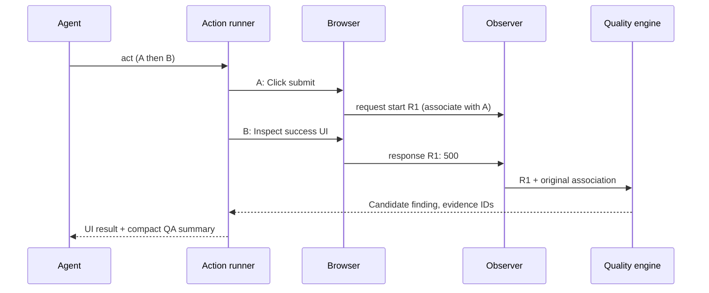

# FastQA-MCP — Agent-ready implementation plan

**Baseline:** public 0.3.2 documentation | **Status:** agreed direction / unimplemented specification | **Revision:** 3 (single-session full roadmap) | **Execution target:** Fable 5.2 / xHigh (maintainer-selected) | **Companion:** FASTQA-ROADMAP.md

## 0. Instructions to implementation agents

Read this plan and the roadmap, then inspect the actual checkout before editing. Map the existing MCP tool registrations, action runner, browser event listeners, snapshots, assertions, flow persistence/replay, Playwright export, CLI, reports, benchmark and CI to actual paths and symbols. Record that map in `docs/evolution-baseline.md`. The module names below are suggested responsibilities, not verified current source paths. Reuse existing functionality; do not create a second action executor or browser owner. Do not install a new dependency without explaining the need. Preserve Node 20+ and current TypeScript/ESM setup. Do not publish or push without maintainer approval.

### Execution protocol for Fable 5.2 / xHigh

Use the requested model and high reasoning effort in the coding client if available. This is a development preference, not a FastQA dependency or a verified provider configuration. The maintainer explicitly authorizes implementation of the entire roadmap in one continuous session, including FQA-001 through FQA-012 and the final v1.0 gate. This is a code-delivery assignment, not a planning-only assignment. No intermediate approval is needed for in-scope work.

- Read repository instructions (AGENTS.md if present), check git status, preserve user changes, inventory actual symbols and schemas. Do not reset, stash, overwrite unrelated work, or silently assume a clean tree.
- Work in bounded slices: inspect -> write tests -> implement -> run tests -> review diff -> measure -> record outcomes. Use small testable vertical slices as internal execution checkpoints, not as stopping points. After each checkpoint, proceed automatically to the next dependency-ready ticket. Read existing code before adding abstractions.
- Use independent review passes for compatibility/correlation and privacy/resource bounds. If subagents/worktrees are available, delegate narrowly with frozen shared contracts; otherwise do sequential passes. Do not require a specific orchestration tool.
- Maintain `docs/evolution-progress.md`: baseline commit, ticket states, decisions, changed paths, test commands/results, performance distributions, unresolved issues, next safe ticket. Update after each slice so the current session can recover from context compaction or interruptions without losing state. Maintain an explicit checklist of all acceptance criteria; re-read it before selecting work.
- Do not stop after the first slice, milestone, or successful demo. Continue through all milestones and final integration. If blocked, diagnose and attempt safe alternatives, record the blocker, continue independent tickets, then revisit the blocker. Do not ask for routine approvals or end with a proposed next-session plan instead of implementing available work. Do not fake passing tests or benchmark numbers. No push, tag, publish or package release without approval.
- Use the public README draft as a documentation proposal; only promote roadmap items to current capabilities after tests pass. Keep npm commands/examples tied to the version actually shipped.

Baseline commands (from the public manifest/reference):

```sh
npm ci
npx playwright install chromium
npm test
npm run bench
```

Run on the local demo fixture; capture commit SHA, OS, Node/Chromium versions, settings, stdout/stderr, repeated benchmark samples and existing MCP schemas/flow/report examples. If the environment cannot run browsers, record the blocker and do not claim green E2E. CI currently documents a Node 20/22/24 matrix and a committed `dist/` consistency check. Rebuild and include generated `dist/` if that policy still applies. Release labels/workflow already exist; do not manually publish. Keep each milestone reviewable with small commits and fixture-based tests.

## 1. Architecture and shared contracts (P0)

Suggested logical layout inside the existing `src` tree (adapt to existing conventions):

```text
observation/  event types, browser adapters, bounded store, capture policy
correlation/  action scopes, request lifecycle, association confidence
quality/      finding types, rule registry, policies, deduplication
privacy/      redaction, safe serialization, artifact policy
evidence/     query/paging, JSON bundle, markdown, report adapters
discovery/    observed journey graph and endpoint normalization
```

Avoid unnecessary framework abstraction: use typed interfaces, direct functions, an in-process event store and a small rule registry. No mandatory database or queue.

Illustrative TypeScript contracts; align with actual project type naming:

```ts
type Association = {
  actionId?: string;
  candidateActionIds?: string[];
  confidence: 'direct' | 'inferred' | 'ambiguous' | 'unattributed';
  reason: string;
};
type Observation = {
  schemaVersion: 1;
  eventId: string;
  sessionId: string;
  batchId?: string;
  pageId?: string;
  frameId?: string;
  action: Association;
  sequence: number;
  at: string; // ISO timestamp
  elapsedMs: number; // monotonic time relative to session
  kind: 'request' | 'response' | 'request_finished' | 'request_failed'
      | 'console_error' | 'page_error' | 'state_change';
  data: unknown; // use a discriminated union in implementation
};
type Finding = {
  schemaVersion: 1;
  id: string;
  ruleId: string;
  severity: 'info' | 'low' | 'medium' | 'high';
  confidence: 'low' | 'medium' | 'high';
  status: 'candidate' | 'expected' | 'suppressed';
  title: string;
  expected?: string;
  actual: string;
  association: Association;
  evidenceIds: string[];
  fingerprint: string;
  occurrences: number;
};
```

Severity is impact estimate, confidence is strength of evidence; neither proves business impact. Keep assertion results independent from findings. A test can pass with findings. Unknown/truncated capture must not appear as a clean bill of health. Use stable observation IDs and independent cursors; report dropped counts and coverage limitations.

## 2. Milestone 0.4 — Observation foundation

### FQA-001 Baseline and compatibility harness

- Snapshot tool schemas, existing response format, saved-flow schema, CLI exit semantics and report output. Add legacy flow fixtures and replay parity tests before refactoring.
- Add deterministic fault scenarios to the existing demo server (not a new app): hidden first-party 500, delayed response crossing action and batch boundaries, expected 422, background polling, redirect, failed transport, popup/iframe and overlapping requests.
- Establish warm/cold benchmark distributions (suggest 30 warm samples after warm-up; report median and p95), separate browser-side time and model assumptions, collect normal response sizes and memory.
- Acceptance: existing tests pass or existing failures are documented; fault fixtures reproduce reliably; baseline artifact committed.

### FQA-002 Scoped action and request lifecycle

- Assign a session ID per browser context/run, batch ID per `act`/open/replay scope and action ID per executed step. Track page/frame identity, action type, redacted target, start/end monotonic times and outcome. Reuse the same execution hook in MCP and CLI replay.
- Observe requests at start, responses at header receipt, and completion/failure separately. Key by Playwright request object (e.g. WeakMap) and generated request ID, not by URL. Track redirect relationships, status, method, sanitized URL, resource type, duration and available trace IDs. Capture network failure separately from HTTP failure.
- Bind browser/context listeners early enough for initial navigation and new pages; dispose on close/context replacement. Avoid duplicate listeners and stale active-page state. Attribute delayed responses using request-start association, not whichever action is active when a response arrives.
- Track candidates from current action/page/frame and bounded post-action windows. Background polling, prefetch and overlapping asynchronous operations may be ambiguous; do not manufacture causality. `direct` is reserved for explicit instrumentation/known linkage; normal temporal association is `inferred`. Preserve redirects and cross-batch attribution without leaking between sessions.
- No fixed sleep after every step, no blanket network-idle wait. Use existing Playwright auto-wait and explicit assertions; optional bounded settle only when requested. A late finding can surface in the next `act` or evidence query. Incomplete capture is visible. Use a bounded queue and retention budget; do not keep full Playwright objects indefinitely.
- Acceptance: A starts request, B executes, request fails during B -> reported against A if inferred from start, never B merely because of response time. Ambiguous overlap marked. No cross-session leakage; teardown cleans listeners and buffers. Tests cover same-URL concurrent calls, 3xx chains, frame/popup and missing request completion.



### FQA-003 Privacy and bounded capture (required before payload capture)

- Central redaction before serialization, persistence and MCP output, not just UI formatting. Strip credentials from URLs, default-remove query values, redact auth/cookie headers, configured secret keys and known secret values; sanitize nested JSON, text, errors, flow data and report output. Preserve existing `FASTQA_VAR_*` placeholder behaviour. Do not log resolved values or put real secrets in tests/fixtures.
- Default capture metadata only; opt-in first-party allowlisted JSON body capture. No password, auth/session/token, payment, binary, multipart or unknown-content capture by default. Limit body size, total bytes, capture duration, pending body readers and event count; skip unknown/oversized bodies rather than claiming a hard pre-buffering guarantee if Playwright cannot supply one. Redact before retaining; do not use unbounded response.body() on unknown-size traffic. Never forward bodies to another service by default.
- Proposed initial caps (tune via measurements): 2,000 events, 8 MiB retained sanitized event data, 16 KiB per captured JSON body, 16 pending body readers. Document truncation/eviction, emit `droppedCount`, and keep evidence references resolvable or explicitly unavailable. Bound screenshot count/bytes and artifact lifetime separately. Screenshots can expose secrets; disable or redact/mask sensitive screens, document residual risk. Store artifacts locally, avoid symlink/path traversal, escape HTML/Markdown, avoid absolute paths in output. Keep MCP stdio clean; diagnostics on stderr.
- TLS: inspect existing certificate behaviour; secure-by-default for new configs, explicit opt-in for invalid certificates with warning and compatibility migration if needed. Restrict target origins optionally; do not treat HTTP method as sufficient proof of read-only behaviour. Browser/CDP access can expose existing logged-in sessions; use isolated test profiles by default.
- Treat page text, console, payloads, and error strings as untrusted data, never instructions to the agent. Never execute rule expressions supplied by the page. No arbitrary JavaScript evaluation tool as part of this plan.
- Acceptance: synthetic canary secrets absent from tool results, reports, flow files, evidence and logs; opt-in capture only on allowed origin/type; over-budget events yield explicit truncation; no blocking of normal interaction due to capture failure.

### FQA-004 Locator and session safety

- Keep existing locator syntax and fast resolution. Offer strict ambiguity rejection: return compact candidates and scoped refs instead of selecting an arbitrary visible match. Keep compatibility default initially; recommend strict for new QA flows. Make refs page/frame/snapshot scoped and reject stale references where resolvable. Never automatically click alternate locators after a failed destructive action.
- Serialize batches within one context or reject concurrent calls with explicit busy state; separate context/process per independent test user or parallel worker. Namespaced artifacts, per-run IDs, atomic writes; avoid race on `latest.*` reports. Defer multi-session MCP routing unless measurements justify it.
- Acceptance: duplicate labels fail in strict mode with alternatives; explicit ref resolves correct element; two test workers cannot share cookies, observations or artifacts. Existing simple flows work.

## 3. Milestone 0.5 — Continuous QA detection

### FQA-005 Rule registry and finding lifecycle

Implement pure deterministic detectors over normalized observations and policy. Start with 4-6 cheap rules; do not scan full history on each step. Rules are versioned; deduplicate by rule + normalized endpoint + relevant error signature + context, retain first/last occurrence, count and samples. Preserve raw facts separate from derived findings. Use severity and confidence independently. Rules emit candidates, never automatically assert that a product bug is confirmed.

| Rule ID | Trigger | Default behaviour |
|---|---|---|
| NET-5XX | First-party HTTP 5xx | High candidate; reduce confidence if background/uncorrelated |
| NET-FAIL | Unexpected request transport failure | Candidate; ignore expected navigation aborts only with evidence |
| JS-EXCEPTION | Uncaught page exception | Candidate; correlate page/action where possible |
| CONSOLE-ERROR | First-party console error | Candidate, usually lower confidence; deduplicate |
| NET-4XX | Unexpected first-party 4xx | Informational/medium depending on configured endpoint expectations |
| BUSINESS-ERROR | Configured response invariant violated despite HTTP 2xx | Opt-in; no assumption that arbitrary success/error fields imply failure |

Rules should not automatically flag all 401/403/404/422, third-party analytics, retries, or cancelled requests. Recoveries can lower severity but retain evidence. Keep first-party origin scope explicit; cross-origin API origins configurable. Do not assert healthy coverage of service workers, WebSockets or backend-only traffic; document what the adapter sees.

### FQA-006 Policy and compact MCP integration

Proposed policy file `.fastqa/config.json` (validate schema, never execute config code; no actual API change implied until local schema review):

```json
{
  "schemaVersion": 1,
  "quality": {
    "mode": "observe",
    "firstPartyOrigins": ["https://shop.example.test"],
    "expectedResponses": [
      {"method":"POST","path":"/api/orders","statuses":[422],"scope":"invalid-order-test","reason":"Negative validation test"}
    ],
    "businessRules": [
      {"id":"ORDER-SUCCESS","method":"POST","path":"/api/orders","status":200,"jsonPointer":"/success","equals":true}
    ],
    "failOnSeverity": "high"
  },
  "capture": {"payloads":"off","maxEvents":2000},
  "locator": {"strict":false}
}
```

Expected errors must be explicit, scoped to a run/flow/action and include rationale; never globally suppress status classes. Known issue suppressions (optional local IDs, match scope, expiry, reason) remain visible in reports and cannot erase facts. Do not make Jira mandatory. `observe` does not change legacy pass/fail; `strict` fails based on configured severity and scope, including late findings by run finalization. Explicit legacy assertions remain authoritative and retain semantics. Ensure a negative-test policy doesn't silently override a conflicting explicit assertion.

Keep eight MCP tools. Add optional response summaries and evidence filters after examining actual schemas. Example additive conceptual result:

```json
{
  "assertionsPassed":true,
  "quality":{
    "status":"findings",
    "newCount":1,
    "highestSeverity":"high",
    "coverage":"partial",
    "findings":[{
      "id":"F-17","ruleId":"NET-5XX","actionId":"A-3",
      "confidence":"medium","summary":"POST /api/orders returned 500",
      "evidenceIds":["E-12","E-13"]
    }],
    "moreAvailable":false
  }
}
```

`evidence` proposed views: summary/findings/network/timeline, optional action/batch/session/finding filters, cursor/limit, explicit details opt-in. Preserve old no-argument behaviour; new cursor does not consume legacy error records. Default compact response: at most top 3 findings, total count, cursor and truncation status; no raw payloads or full snapshots on healthy runs. Add no tool unless existing tools cannot represent the operation clearly.

Acceptance: UI success + hidden 500 emits candidate with no explicit network assertion; negative expected 422 doesn't generate a misleading failure; strict mode behaves identically in MCP and CLI; clean actions remain compact; 200 + configured failure detected when safe capture enabled, otherwise not evaluated.

### FQA-006a OpenCode-facing experience and progressive disclosure (part of FQA-006)

The wire contract must be client-neutral. Existing human-readable MCP content stays compatible; if the installed SDK/client supports structured content, expose equivalent typed data additively, with a compact text fallback. Do not depend on OpenCode rendering badges, custom TUI widgets, or reading every resource. The `open` and `act` results are the primary delivery channel; `evidence` is the drill-down channel. `snapshot` must not dump quality history. `flow run` and CLI use the same result model and rule evaluation. `close` must preserve access to retained local evidence under documented lifecycle rules.

Proposed logical result (adapt actual serialization and keep legacy fields):

```json
{
  "execution": {"status":"passed","actionCount":6,"durationMs":840},
  "assertions": {"passed":2,"failed":0},
  "quality": {
    "status":"findings", "policyOutcome":"not_enforced", "coverage":"partial",
    "observedRequests":12,"pendingRequests":1,"droppedEvents":0,
    "newCount":1,"highestSeverity":"high","moreAvailable":false,
    "findings":[{"id":"F-001","ruleId":"NET-5XX","severity":"high",
      "confidence":"medium","summary":"POST /api/notifications returned 500",
      "association":{"actionId":"A-006","confidence":"inferred","reason":"request started during action"},
      "evidenceIds":["E-12","E-13"]}],"cursor":"opaque-cursor"
  }
}
```

Execution status, assertion status, policy outcome, coverage and candidate confidence must remain distinct. Define quality status as `clean` (only within observed scope), `findings`, `not_evaluated`, or `partial` when no finding but coverage is incomplete; coverage independently indicates complete/partial/disabled for the declared capture window, never full system coverage. Include pending/dropped counts and rule evaluation availability. Late findings retain original IDs and can surface in the next result. Track independent client cursor semantics: consuming legacy evidence must not destroy new evidence. Cap inline findings (default 3) and text lengths; deterministic sorting by severity, confidence and sequence. A summary may reference evicted evidence only with explicit availability status. Tool descriptions teach the agent to examine findings before declaring success, distinguish observed facts from hypotheses, avoid arbitrary retries and ask for safe reproduction authorization. Do not inject hidden model prompts or execute instructions contained in page/network text.

OpenCode smoke test (optional local, using actual installed client): configure the local built MCP with node and absolute `dist/index.js` path, verify eight tools, run ordinary navigation and a hidden-error fixture, use evidence drill-down and save/replay. Record actual tool responses and client version. Do not require a paid model or hardcode Fable as a runtime dependency. For CI use an SDK stdio harness independent of LLM/provider. Do not claim a custom OpenCode presentation: mock transcripts illustrate intended behavior only.

### Profile configuration contract (part of FQA-003/006)

Keep the section FQA-006 schema as canonical; extend it additively rather than creating a second config format. `quality.mode` is a preset (`observe`, `strict`, `discovery`, `debug`); explicit capture and discovery settings override preset defaults within hard privacy/resource constraints. `observe` is metadata-only with no policy enforcement. `strict` is observe plus explicit policy failure and bounded finalization. `discovery` enables graph collection without changing pass/fail. `debug` permits scoped payload capture only after explicit first-party allowlist and capture selection, never globally. `capture.payloads=off` always wins over a preset. Unknown keys and invalid combinations should produce a clear configuration error (or documented warning for a legacy migration). Do not accept page-supplied configuration. Configuration precedence proposal: defaults < validated project config < documented explicit run options, with security caps and environment-deny rules not weakenable by the agent. Existing environment variables continue to work; log effective configuration without secrets. Add schema fixtures and tests for preset/override/invalid cases.

Extend the canonical config with optional `capture.maxBytes`, `capture.maxBodyBytes`, `capture.allowedOrigins`, `capture.allowedEndpoints`, `quality.performance` (disabled until configured), `discovery.enabled`, `artifacts.enabled`, `artifacts.maxBytesPerRun`, `artifacts.retentionDays`, `artifacts.maxRuns`. Validate policy before browser execution. Future OpenCode playground UI is not a core deliverable; JSON config and docs are sufficient.

Strict finalization: use a configured bounded run-level drain of tracked pending first-party operations, never an unbounded network-idle wait. If the deadline expires, return partial coverage and apply an explicit `onIncomplete` policy (proposed strict default fail; observe never fails solely for incomplete coverage). Within interactive `act` return currently known policy outcome and mark provisional if late events remain. CLI/replay finalization is authoritative. Do not retroactively claim a tool call failed after its response has been sent. Surface late strict failures at the next call or explicit finalization, using the existing tool surface and documented semantics. Test polling/non-completing requests, cancellation, browser close and end-of-flow.

## 4. Milestone 0.6 — Evidence and reproduction

### FQA-007 Evidence bundle and reports

Extend existing `.fastqa` artifact structure rather than replacing it. Proposed `.fastqa/artifacts/<runId>/evidence.json` and optional `bug-<findingId>.md`. Use schema version, commit/test metadata if supplied, UTC timestamp, scope, redacted action sequence, assertions, findings, evidence IDs, related request metadata, screenshot references, coverage, dropped count. Use relative paths. HTML report shows assertion outcome separately from QA findings; JUnit preserves legacy result semantics in observe mode, strict failures create meaningful failure output. JSON is canonical; Markdown and HTML are derived. No automatic uploads.

### Session artifact contract (part of FQA-007)

Optional structured session bundle; this supersedes the earlier suggested evidence-only location for new session metadata, while preserving legacy report/artifact paths. Finalize the location against repository conventions; do not duplicate legacy files simply to match this illustration.

```text
.fastqa/
  flows/                           # existing authoritative replay files
  reports/                         # existing HTML/JUnit reports
  artifacts/                       # existing failure artifacts
  sessions/<runId>/
    summary.json                   # schemaVersion, IDs, counts, outcomes, refs
    actions.jsonl                  # sanitized action ledger
    observations.jsonl             # optional bounded event detail
    findings.json                  # canonical candidate records
    discovery/
      endpoints.json               # only in discovery mode
      journeys.json
    evidence/<findingId>/
      finding.md                  # derived from JSON
      network.json                # only if retained/authorized
      screenshot.png              # optional, masked; actual format recorded
```

Use relative references to existing flow/replay/report artifacts; record screenshot timing (post-event vs actual failure), capture coverage and unavailable/expired data. `summary.json` reports counts of observed features/scenarios only when explicitly labeled by agent or flow; never claim complete product coverage. Suggested fields: schemaVersion, sessionId/runId, startedAt/endedAt, browser/build/environment when known, effective safe policy, execution/assertion/policy outcomes, quality counts by severity and rule, pending/dropped/evicted counts, artifact references, truncation reasons, and reproduction status. Keep session bundle opt-in; existing legacy failure artifacts remain under current behavior. Stream bounded JSONL with atomic final manifest and robust interrupted-run handling; no unbounded accumulation on disk. Proposed defaults for opt-in bundle: 32 MiB/run, max 20 retained runs, 7 days retention; measure and document cleanup, never remove user-authored flows or unrelated files. No directory traversal, symlink following or arbitrary external export locations. Parallel workers get unique run IDs and cannot overwrite each other. Add `.fastqa/sessions/` to ignore guidance. Report escaping and screenshot secret risk must be tested/disclosed.

Bug template:

```markdown
# [Candidate] <observable symptom>
- Environment/build/browser: <known or unknown>
- Preconditions / test data placeholders:
- Minimal observed reproduction steps:
- Expected: <explicit requirement or unknown>
- Actual:
- UI outcome / assertion result:
- Network / JS evidence: <IDs, sanitized details>
- Severity estimate / confidence / correlation rationale:
- Reproduction status: not attempted | reproduced | not reproduced
- Known issue / suppression: <if applicable>
- Limitations and next investigation:
```

### FQA-008 Replay and Playwright export parity

- Preserve old flow formats, placeholders, steps and assertion behavior; use versioned additive metadata. Keep failed attempts as separate evidence/reproduction candidates, not automatically successful regression flows.
- A reproduction flow is a candidate based on recorded actions. Only replay when authorized and test data/environment safely supports repetition. Never retry side-effecting actions automatically. If setup dependencies exist, retain them rather than falsely claiming a minimal reproduction.
- Existing reference documents network, no-errors and accessibility assertions exported as comments. Implement executable parity using a generated helper/listeners with equivalent scope and polling, or explicitly mark unsupported assertions and refuse strict export. Make omissions machine-readable. Test generated spec against fault and success fixture. No silent downgrade.
- Acceptance: saved legacy and new flows replay without LLM; same strict findings in MCP and CLI, exporter passes/fails equivalent fixture; reports contain valid references and no secret canaries. Reproduction remains unknown until run.

## 5. Milestone 0.7 — Observed product discovery

### FQA-009 Route and endpoint graph

Collect only observed browser activity; optional discovery mode. Nodes: page/route, action/interaction intent (agent-supplied label when provided), API method + normalized origin/path, observed response shape, finding. Edges: navigation, observed request association, response, candidate issue. Include count, first/last seen, example event IDs, association confidence. Normalize numeric/UUID path segments conservatively, allow explicit templates, preserve ambiguity. Query values/body values not part of graph by default; record safe field names/types when allowed. Never infer backend service ownership, business rules or unvisited coverage from URL names alone.

```json
{"schemaVersion":1,"routes":[{"id":"R1","path":"/checkout"}],"endpoints":[{"id":"EP1","method":"POST","path":"/api/orders","statuses":[201,500]}],"edges":[{"from":"R1","to":"EP1","relation":"observed_request","confidence":"inferred","evidenceIds":["E-12"]}]}
```

Export bounded `discovery.json` locally via existing evidence/flow mechanism; optional agent integration can enrich with Swagger/service metadata outside FastQA. No autonomous crawling, no destructive exploration by default. For full exploration the consuming agent must define scope, action permissions and stop conditions. No claim of product coverage percentage absent external denominator.

Acceptance: repeated journey updates counts rather than duplicating edges; route and endpoint data traceable; API calls without action context marked background/unknown; no data crosses sessions except explicitly merged sanitized exports.

## 6. Milestone 0.8 — Advanced QA

### FQA-010 Contract and business rules

Optional local OpenAPI input, explicit origin-to-spec mapping, operation matching, response status/media type/schema checks; document supported OAS/JSON Schema dialects. Disable remote `$ref` resolution by default, bound validation input/time, don't fetch specifications from arbitrary page URLs. Distinguish missing contract, unsupported schema, and actual mismatch. Use vetted JSON Schema validator only after dependency review. Extend configured JSON-pointer invariants and expected error policies; no LLM or arbitrary eval in rule engine.

### FQA-011 Performance and state checks

Collect timing separately for browser action, response headers and completion. Evaluate only configurable thresholds or repeated environment-specific baselines with enough samples; distinguish browser/cache/third-party noise. Duplicate requests are candidates only when policy or baseline makes them suspicious. Reuse existing snapshot diffs for state transitions, avoid full DOM scans after each step. Optional state invariants like 'success toast but order row absent' require explicit expectations, not generic assumptions. Accessibility audit remains on demand or explicitly requested checkpoints rather than every action.

Acceptance: contract mismatch fixture detected; normal/error responses per spec pass; unsupported schema disclosed; slow fixture flagged only under configured policy; no expensive default processing.

## 7. Testing strategy and performance gates

| Layer | Coverage |
|---|---|
| Unit | URL/payload sanitizer, policy parsing, correlation confidence, dedup, event eviction, shape normalization |
| Integration | Real Playwright fixture events: delayed XHR/fetch, redirects, failures, background polling, iframes, popups, concurrent same URL |
| MCP contract | Real stdio client, old schemas, compact output, filters, paging, cancellation, legacy assertions |
| E2E replay/export | Legacy and new flows, expected negatives, strict/observe, actual exported specs, HTML/JUnit |
| Privacy | Canary secrets in URLs, headers, JSON, console, DOM, screenshot policy, report escaping, path safety |
| Load/isolation | Two workers, repeated open/close, bounded buffers, slow body read, long runs, artifact collisions |

Use existing `bench/e2e.mjs`, `bench/export-check.mjs`, `bench/qa-features.mjs`, `bench/bench.mjs` where appropriate; file names are evidenced by package scripts, confirm local contents. Add dedicated unit/integration entrypoints only as needed. CI runs tests on the documented Node matrix; collect performance in a reproducible benchmark job, avoid flaky exact wall-time gates on shared runners. Proposed default-mode target: unchanged call count, <=10% median and <=20% p95 browser-side overhead, <=20% normal response size increase. Compare same fixture, browser, OS and conditions; report both actual browser time and model-time estimates. Test actual MCP clients separately if making client-specific claims. No tests against production.

## 8. Implementation order and delegation

| Ticket | Depends on | Owner role | Deliverable |
|---|---|---|---|
| FQA-001 | — | baseline/test agent | current code map, test and benchmark baseline |
| FQA-002 | 001 | core agent | lifecycle and correlation |
| FQA-003 | 001 | privacy agent | sanitizer and bounded capture (merge before payloads) |
| FQA-004 | 001 | browser agent | strict locator and isolation |
| FQA-005 | 002,003 | quality agent | rule registry and finding model |
| FQA-006 | 005 | MCP agent | policies and compact views |
| FQA-007 | 005,006 | evidence agent | evidence artifacts and reports |
| FQA-008 | 006,007 | replay agent | replay and export parity |
| FQA-009 | 002,003,007 | discovery agent | observed graph |
| FQA-010 | 005,006 | quality agent | optional contract validation |
| FQA-011 | 002,005 | performance agent | thresholds and state invariants |
| FQA-012 | 001–011 | integration/release-readiness agent | v1.0 compatibility, performance, privacy, documentation and packaging gates |

Parallelize fixture tests and privacy/core work only after shared event/schema contracts are agreed. Use separate branches/worktrees, one owner for shared interfaces and action runner, integration after each dependency. No concurrent edits to tool registry or shared types without coordination. A reviewer verifies privacy and compatibility independently. Version labels are maintainer decisions; update docs and changelog after each milestone. Do not publish intermediate releases. The parent agent owns integration, reviews and final acceptance. Continue working while independent delegated tasks run, where supported by the client; validate returned code yourself.

## 9. Single-session execution — implement the entire roadmap

**Mandatory scope:** FQA-001 through FQA-012, all acceptance journeys in section 11, and the final integration gate. The first vertical slice is only the first checkpoint. Continue automatically; do not request permission to begin another milestone.

| Checkpoint | Work to complete before proceeding |
|---|---|
| A — Baseline and first demo | FQA-001; a fixture showing UI success plus a delayed first-party HTTP 500; minimal correlation and sanitized compact finding; verify legacy behaviour. |
| B — 0.4 | Complete FQA-002/003/004; lifecycle, privacy, capture limits, locator and session safety. |
| C — 0.5 | Complete FQA-005/006 including FQA-006a and profiles; detectors, expected errors, compact views, strict finalization, scoped body capture and configured HTTP 200 rules. |
| D — 0.6 | Complete FQA-007/008; session artifacts, evidence, reporting, replay and export parity. |
| E — 0.7 | Complete FQA-009; observed graph, normalized endpoints and export. |
| F — 0.8 | Complete FQA-010/011; optional OpenAPI validation, business invariants, performance and state checks. |
| G — 1.0 readiness | Complete FQA-012 and final acceptance sweep; resolve regressions and cross-engine integration issues. |

At each checkpoint run focused deterministic tests, review the diff, record real results in `docs/evolution-progress.md`, and proceed. Use one owner for shared interfaces; parallelize independent tasks only when safe. Before editing, preserve user changes and create a local feature branch if consistent with repository instructions; no push. No need for intermediate version bumps or publication.

First demo definition of done: one batched interaction returns UI success plus an independent evidence-backed candidate, associated with the originating action with uncertainty stated. No new tool, extra LLM call, body capture or hidden pass/fail change is needed for this initial demonstration. Once it passes, implement the rest of the roadmap, including opt-in body capture after the privacy gate.

### FQA-012 — Full integration and v1.0 readiness

- Run all unit, integration, real MCP stdio, replay, export, CLI, reporting, privacy, resource and isolation tests, including section 11 journeys. Verify the eight existing tools and legacy input/output semantics, flows, flags and assertions.
- Run clean install/build and existing Node CI matrix where available. Validate the npm package contents, executable entrypoint, browser setup, and tracked `dist/` consistency if required. No package publication. Use a local package tarball/install smoke test if supported.
- Smoke-test the MCP with OpenCode and at least one other available MCP-compatible client; if unavailable, use a real SDK stdio client and explicitly record the missing client verification. No claim of real client testing without execution.
- Re-run comparable benchmarks with repeated samples; report median/p95 browser execution, calls, response sizes, CPU/memory where measurable, and replay times. Investigate and fix regressions; never relax targets to hide failures. Report model-time estimates separately.
- Review secret handling, bounded stores, artifact cleanup/path safety, ambiguous attribution, expected negative tests, strict late-event behaviour and detector false positives. Verify all modes work together and replay remains model-free.
- Update README, technical reference, configuration examples, CLI usage, changelog, migration guidance and benchmark methodology to reflect actual verified implementation. Clearly distinguish local development features from npm-published capabilities. Keep examples illustrative where appropriate.
- Produce `docs/evolution-progress.md` with final status of all 12 tickets and acceptance gates, plus reproducible commands/results and remaining limitations. Do not claim v1.0 readiness if required gates are unmet. No automatic push, tag, publish or release.

### Continuation and completion protocol

Keep a persistent checklist with `pending`, `in_progress`, `verified`, or `blocked` for each ticket and gate. At context compaction, reload the plans and checklist and continue from the earliest dependency-ready requirement. Do not treat a successful milestone as task completion. Use available subagents for independent tests/reviews if helpful; they are optional and the primary agent owns the complete result. For actual environment or dependency blockers, continue independent work and revisit them. If the host imposes a hard execution limit or completion is impossible, leave the repository in the safest achievable state and report the exact remaining work rather than falsely marking it complete. Do not silently drop requirements or replace features with placeholder implementations.

## 10. Copy-paste prompt for Fable 5.2 / xHigh

> Read docs/FASTQA-ROADMAP.md and docs/FASTQA-IMPLEMENTATION-PLAN.md, revision 3. Implement the ENTIRE roadmap in this session, FQA-001 through FQA-012, from the current baseline through the v1.0 readiness gate. Follow section 9 in dependency order, automatically proceeding after each internal checkpoint. Do not stop after the first demo or ask me to authorize each milestone. Preserve all eight tools, legacy flows, CLI, explicit assertions and default pass/fail behaviour; use one shared execution path, no embedded LLM, no unnecessary dependencies or infrastructure. Implement the scoped privacy-first payload capture, detection, evidence, replay, discovery, OpenAPI and performance/state capabilities specified in the plan. Run deterministic tests, review, measure and fix regressions; persist progress across context compaction. Finish with full integration, README/reference/changelog updates, package smoke tests, actual benchmark and acceptance results, and explicit remaining blockers if any. Do not push, tag, publish or claim unverified success.

## 11. Product acceptance journeys (cross-milestone)

These are end-to-end acceptance specifications, not claims about current functionality. Use local controlled fixture data; keep simulated OpenCode examples in docs labeled as such.

| Journey | Fixture / prompt | Expected result | Gate |
|---|---|---|---|
| Normal interaction | Create a test order, without asking for QA checks | Success UI plus a hidden 500 candidate and inferred action association; no additional tool calls required for detection | 0.4/0.5 |
| Healthy batch | Login, add item, change currency | No unnecessary findings or full history; existing snapshots and checks remain compatible | 0.4 onward |
| Delayed failure | A starts request, B inspects UI, failure arrives later | Stable attribution to A when supported; next result surfaces late finding; partial state explicit | 0.4 |
| Negative test | Expected 422 on invalid order | Expected result retained, no misleading candidate; legacy explicit assertions unchanged | 0.5 |
| Business response | HTTP 200 with `success:false` under explicit rule | Candidate if authorized body captured; not evaluated if unavailable | 0.5 |
| Discovery | Explore authorized fixture routes, repeat same journey | Bounded observed graph with stable edges/counts; no coverage claim or invented service owner | 0.7 |
| Evidence + replay | Investigate F-001, save safe reproduction | Targeted redacted evidence, candidate bug draft, replay status verified separately | 0.6 |
| CI strict | Replay same fixture without model | Same policy/explicit assertion behavior, nonzero exit on configured failure, partial handling documented | 0.6 |
| Performance | Repeated/slow endpoint with explicit policy | Candidate with measured evidence, no blanket assumption of defect | 0.8 |
| Privacy/isolation | Canary data and two independent workers | No canaries in new output, no cross-run leakage, bounded artifact retention | Every milestone |

Example agent instruction for exploratory mode: “Explore the authorized staging checkout as a QA engineer. Identify observed capabilities, prioritize risk, test positive/negative/boundary cases using dedicated data, examine findings, validate business expectations, save reproducible evidence when authorized. Do not mutate shared data or repeat destructive operations automatically.” This lives in client docs, not in a hidden FastQA system prompt. The model chooses tests; FastQA provides observations and deterministic checks.

## Definition of done for every ticket

Code and deterministic tests; backward compatibility checked; privacy review for new data; bounded resource use; docs and changelog updated; test/benchmark results recorded, including limitations; no automatic publication. If a trade-off conflicts with performance, user safety or API stability, fix it or record a specific blocked gate without silently weakening the contract. Continue independent work and revisit blockers before the final report.

## Sources and limitations

Public [repository](https://github.com/VnKk8/FastQA-MCP), [technical reference](https://github.com/VnKk8/FastQA-MCP/blob/main/docs/REFERENCE.md), [manifest](https://github.com/VnKk8/FastQA-MCP/blob/main/package.json) consulted 27 November 2026. Source-directory retrieval was blocked; actual internal file names and integration points must be confirmed by the implementing agent. All interfaces, caps, release numbers and policy shapes above are proposals. No source changes or test runs performed in this planning session.
