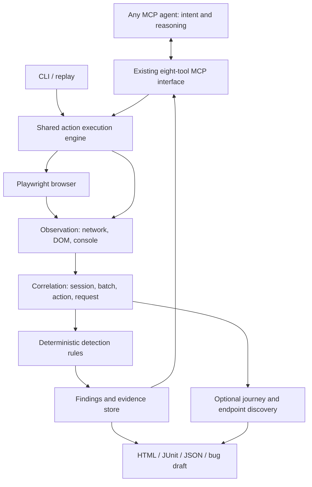

# FastQA-MCP — Product evolution roadmap

**Maintainer-agreed product direction | Baseline: 0.3.2 | Revision 3 — full-roadmap single-session execution | 27 November 2026**

> A QA-native browser interaction engine for AI agents. Navigate faster. Observe deeper. Discover defects while interacting.

## Vision

FastQA should be a standalone, local-first browser execution and quality observation engine. An agent supplies intent and selects tests; FastQA performs actions, observes application behaviour, applies deterministic rules, and delivers compact, traceable evidence. No embedded LLM, hosted service, database, or dependency on a particular agent framework is required.

The differentiator is not simply a faster Playwright MCP: it is continuous quality observation without requiring the agent to explicitly request every check. This is not a claim of autonomous comprehensive testing or proof of correctness.

## Existing strengths to preserve

The public 0.3.2 reference documents eight MCP tools, batches of up to 50 actions, compact snapshots and diffs, iframe and shadow DOM support, explicit assertions, network/error recording, flow replay/export, CLI, HTML/JUnit reporting, and environment-variable secret substitution. Do not rebuild these features. The existing demo benchmark reports 10 vs 2 calls and estimated end-to-end latency based on an assumed model turn time; reproduce before advertising improvements. [Reference](https://github.com/VnKk8/FastQA-MCP/blob/main/docs/REFERENCE.md).

## Target architecture



The observation engine captures facts. The correlation engine links observations with explicit uncertainty. The detection engine identifies rule violations and suspicious patterns. The agent supplies business context and decides what to investigate. These responsibilities must remain separate.

## Proposed release sequence

| Milestone | Scope | Demonstrable result |
|---|---|---|
| 0.4 — Observation foundation | Event IDs, request lifecycle, correlation, bounded capture, sanitization, strict locator option | A delayed HTTP 500 is linked to the originating action or explicitly marked uncertain, even when UI looks successful. |
| 0.5 — Continuous QA | Finding model, automatic detectors, expected-error policies, deduplication, compact summaries | An agent sees a meaningful QA finding without having asked for an assertion. |
| 0.6 — Evidence and reproduction | JSON/Markdown evidence, screenshots on demand, replay parity, export parity | An agent can hand a developer a reproducible defect candidate, with limitations stated. |
| 0.7 — Discovery | Observed routes, action-to-endpoint edges, field and response shape summaries, journey export | FastQA maps observed journeys and API usage without claiming coverage of unseen functionality. |
| 0.8 — Advanced QA | Optional OpenAPI validation, configured business invariants, performance baselines, richer state checks | An HTTP 200 business error or contract mismatch is detected using known application expectations. |
| 1.0 — Stable product | Compatibility, multi-client smoke tests, isolation, docs, performance and privacy gates | A small, dependable, independently installable QA engine suitable for CI. |

Versions are milestone labels, not commitments to intermediate releases. The maintainer authorizes the entire roadmap (0.4 through 1.0) in one continuous coding-agent session. Implement in dependency-ordered vertical slices, verify each, and automatically continue to the next milestone; no intermediate user approval or release is required. Move basic configured HTTP 200 detection into 0.5; reserve richer contract validation for 0.8.

## Example experience

Agent asks: “Create a test order, verify the UI success message, and investigate anything unexpected.” FastQA batches form actions and assertions. UI passes, but a correlated first-party request returns HTTP 500. FastQA reports the assertion as passed, observation as complete or partial, and a separate high-priority candidate finding. The agent investigates context and can reproduce only when safe. Expected negative-test responses do not become false-positive bugs.

## The intended OpenCode experience

FastQA should work through ordinary MCP calls; no OpenCode plugin, custom terminal UI, or provider-specific code is required. A capable consuming model interprets concise tool results and can retrieve more evidence when necessary. Exact terminal rendering is client-dependent.

### Journey A — ordinary browser interaction

```text
You: Create a test welcome bonus worth €100 in the staging back office.
Agent: I will navigate, fill the form and verify success.
  fastqa_open  → page snapshot
  fastqa_act   → navigate to Bonus Management
  fastqa_act   → fill, save, assert success (one batch)

UI / explicit assertions: PASS
QA observation: 1 new candidate, partial coverage (1 pending request)
F-001 HIGH · POST /api/notifications → 500
Associated action: Save Bonus · inferred association
Evidence: available on demand

Agent: The bonus was created, but a related notification request failed.
```

The agent did not ask for a network assertion. This is the desired passive quality signal. A finding is not a confirmed defect. No hidden additional browser action or model call is required for detection. The example is illustrative, not an implemented feature or benchmark.

### Journey B — exploratory testing

The user authorizes exploration of a test environment with dedicated data. The agent identifies observed capabilities, proposes positive/negative/boundary scenarios, executes safe batches, retrieves evidence for suspicious outcomes and verifies business expectations before classifying them. It may save an authorized reproduction flow and replay it without AI. FastQA provides facts, not a test strategy or unverified business requirements.

### Journey C — CI and investigation

A saved flow runs in CI without a model. Observe mode produces findings without changing legacy exit status. Strict mode can fail the run according to a configured policy. A sanitized report links steps, findings and observations. External agents may use those IDs, trace identifiers, source code, logs and requirements to investigate root cause. FastQA never needs those external integrations to operate.

## Product experience contracts

| Consumer | Expected output |
|---|---|
| Agent during a healthy batch | Existing compact page diff + small quality summary (when enabled) |
| Agent during a suspicious batch | Top findings, association confidence, evidence IDs, pending/truncation indicators |
| Agent investigating | Targeted evidence views with filters, cursor and limit |
| Developer | Optional structured session bundle and Markdown candidate bug report |
| CI | Existing HTML/JUnit plus optional machine-readable quality summary; explicit assertion and policy outcomes |
| Discovery agent | Observed routes, journeys, API relationships and evidence references; no invented backend ownership |

Progressive disclosure is a product requirement: detailed payloads, timelines, screenshots and discovery graphs must not be sent to the model by default. Keep clean interactions cheap. The four modes below share one execution and event pipeline.

## Product modes

- **Observe (default)**: passive low-cost monitoring; findings do not silently alter existing assertion semantics.
- **Strict (opt-in)**: configured findings fail execution/CI; explicit expected negative cases are supported.
- **Discovery (opt-in)**: enrich the observed route/endpoint graph; no independent traversal or automatic destructive operations.
- **Debug (opt-in)**: bounded, redacted payload capture for selected first-party endpoints; no sensitive data by default.

Modes are policy presets, not four separate implementations. Keep the eight existing tools; add optional parameters or evidence views only when needed. Avoid flooding the model with raw events.

## Success metrics and release gates

Baseline before changes. On the same fixture, measure cold/warm browser time, MCP round trips, tool schema bytes/tokens, response bytes/tokens, replay time, CPU and memory. Proposed targets: retain the existing call count on the normal journey, <=10% median browser-side overhead in default mode and <=20% p95 overhead; keep normal responses within the existing baseline +20% when no finding occurs. Measure actual LLM latency separately if claiming it. Run repeatable tests for delayed calls, expected 4xx, background traffic, redirects, ambiguous locators, redaction and concurrent sessions. A failed gate requires explanation or redesign, not changed thresholds to make CI green.

## Local artifact experience (proposed)

Keep existing flows/reports compatible; add optional per-session storage beneath `.fastqa/sessions/<runId>/`. The canonical JSON summary references sanitized actions, observations, findings, optional screenshots, discovery exports and bug drafts. Avoid duplicating saved flows or existing reports; use relative references. Limit size, retention and capture scope; record omissions. No silent uploads, automatic Jira submissions or mandatory storage service. See the implementation plan for the exact proposed contract.

## Release positioning

Use one clear message across README, npm and release notes: **Every interaction is a testing opportunity. Every observation is evidence. Every unexpected behaviour is a potential discovery.** The README must label the v0.3.2 capabilities separately from future examples. Publish benchmark methodology and measured browser time separately from model-time estimates; do not claim a universal speedup. Do not advertise full automatic bug detection, body capture, action correlation or strict policy until shipped and validated.

## Non-goals

No custom browser engine, no mandatory vector database, no AI inside MCP, no automatic bug submission, no auto-healing that silently changes test intent, no unrestricted API fuzzing or mutation, no vendor-specific Jira/Kibana integrations in core. Provide neutral JSON artifacts for external integrations, including QA Intelligence Framework. Backend-only traffic and business intent not observed in the browser cannot be inferred as facts.

## Start here

Read `FASTQA-IMPLEMENTATION-PLAN.md` and `FABLE-5.2-XHIGH-START.md`. Begin with baseline tests and the first vertical slice: action correlation -> hidden failure -> compact evidence -> deterministic test. Then continue through every remaining ticket and the v1.0 integration gate in the same session. Milestones are internal checkpoints, not stopping points. Do not start with discovery graphs, UI dashboards, or a major refactor. The final target is the integrated, tested roadmap implementation; publishing is separate and not authorized. If a real blocker prevents a ticket, record it, continue independent work, retry blocked integration where possible, and report any unfinished requirements truthfully.

## Sources and limits

Public [README](https://github.com/VnKk8/FastQA-MCP), [technical reference](https://github.com/VnKk8/FastQA-MCP/blob/main/docs/REFERENCE.md), [package manifest](https://github.com/VnKk8/FastQA-MCP/blob/main/package.json), consulted 27 November 2026. This is a proposed design, not a completed implementation. Full source tree access was unavailable during planning; agents must verify actual files and schemas in the local checkout. No benchmarks or tests were run here.
